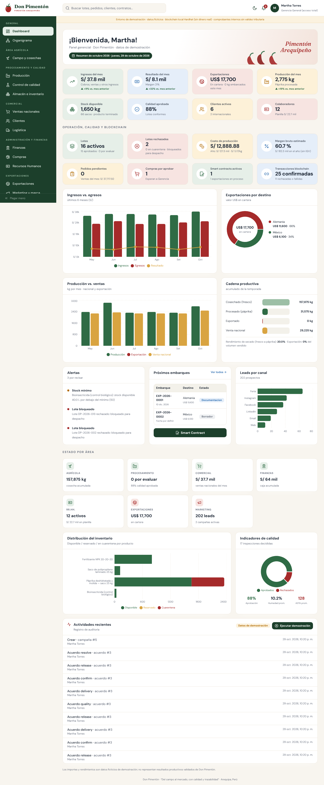

# DON PIMENTÓN ERP | Agroindustrial Management & Blockchain

> *"Del campo al mercado, con calidad y trazabilidad"*

Prototipo **funcional** de ERP para Don Pimentón (microempresa agroindustrial familiar de Arequipa, Perú): cultivo, deshidratado, molienda y venta de páprika en sacos de 25 kg. Integra agricultura → producción → calidad → inventarios → ventas → logística → finanzas, y un módulo de **Smart Contracts reales** (Solidity, red Ethereum local Hardhat) para trazabilidad de lotes y pago condicionado de prueba.

Moneda principal: **PEN (S/)**; operaciones internacionales en **USD** con tipo de cambio registrado. Interfaz en español.

> ⚠️ **Entorno de demostración.** Todos los datos son ficticios. La blockchain es local y sin valor económico. Los comprobantes son documentos internos sin validez tributaria. Rendimientos, costos y especificaciones de calidad precargados son valores de demostración, **no** resultados productivos validados ni límites regulatorios.

---

## Contenido

| Carpeta | Qué contiene |
|---|---|
| `blockchain/` | Contratos `PaprikaTraceability.sol` y `PaprikaTradeAgreement.sol`, pruebas Hardhat, script de despliegue local |
| `backend/` | API Node.js + TypeScript (Express modular), Prisma ORM, PostgreSQL, migraciones, datos demo, integración ethers.js, PDF/Excel, pruebas (Vitest + Supertest) |
| `frontend/` | Next.js 14 + React + TypeScript + Tailwind + Recharts; componentes estilo shadcn/ui; prueba E2E (Playwright) |
| `docs/` | [Arquitectura](docs/ARQUITECTURA.md) · [Reporte de pruebas](docs/REPORTE_PRUEBAS.md) · [Escenario de demostración](docs/ESCENARIO_DEMO.md) |
| `docker-compose.yml` | PostgreSQL + Hardhat + API + Web |

---

## Instalación y ejecución

### Publicar en internet (Render)

[](https://render.com/deploy?repo=https://github.com/Yoshue-Glitch/don-pimenton-erp)

El archivo `render.yaml` crea un servicio web con el `Dockerfile` de la raíz (Hardhat + API + Web en un solo contenedor) y una base PostgreSQL gestionada. Pasos:

1. Cree una cuenta en https://render.com con su cuenta de GitHub.
2. Pulse el botón de arriba (o en Render: *New → Blueprint* y elija este repositorio) y confirme con *Apply*.
3. Espere a que termine la construcción (≈ 10 min la primera vez). La URL pública aparece en el servicio `don-pimenton-erp` (p. ej. `https://don-pimenton-erp.onrender.com`).
4. La contraseña de los usuarios demo **no** es la documentada: Render genera una aleatoria. Véala en *don-pimenton-erp → Environment → DEMO_PASSWORD*.

Comportamiento en el plan gratuito (verificado simulando el contenedor):
- El servicio se suspende tras un rato sin visitas; la siguiente visita tarda ~1 min en despertar.
- La red Hardhat vive en memoria: al reiniciarse el contenedor, la API detecta la red nueva, **archiva** el historial blockchain anterior (marcado "red reiniciada"), marca los lotes como no registrados y redespliega los contratos. Los datos del ERP se conservan en PostgreSQL. Para volver a tener el escenario completo en cadena use *Demostración → Reiniciar demostración*.
- El contenedor usa ≈ 300 MB de RAM (límite gratuito: 512 MB). Si Render informa falta de memoria, cambie el plan del servicio a *Starter*.
- Las condiciones del plan gratuito (p. ej. caducidad de la base de datos gratuita) las fija Render y pueden cambiar; revíselas en su panel.

### Opción A — Docker Compose

```bash
docker compose up --build
```

Abra http://localhost:3000. La API corre en :4000 y la red Hardhat en :8545. Al iniciar, la API aplica migraciones, carga los datos de demostración (solo si la base está vacía) y despliega los contratos.

> Los archivos Docker se incluyen pero **no pudieron probarse** en el entorno donde se desarrolló el prototipo (sin daemon Docker). La opción B sí fue verificada de punta a punta.

### Opción B — Local (verificada)

Requisitos: Node.js 20+ (probado con 22), PostgreSQL 14+ (probado con 16; el índice `NULLS NOT DISTINCT` requiere ≥ 15).

```bash
npm run install:all
```

Cree la base de datos (ajuste `backend/.env` si usa otras credenciales):

```bash
psql -U postgres -c "CREATE USER donpimenton WITH PASSWORD 'donpimenton' CREATEDB;" -c "CREATE DATABASE donpimenton OWNER donpimenton;"
```

En una terminal, levante la blockchain local (déjela abierta):

```bash
npm run chain
```

En otra terminal, migre, cargue datos demo y despliegue contratos (el seed despliega automáticamente si Hardhat está activo):

```bash
npm run db:migrate
```

```bash
npm run db:seed
```

Inicie la API:

```bash
npm run api
```

En otra terminal, inicie la web:

```bash
npm run web
```

Abra **http://localhost:3000**.

Comandos opcionales:

```bash
npm run contracts:compile
```

```bash
npm run contracts:deploy
```

(`contracts:deploy` escribe `blockchain/deployments/localhost.json`; la API también puede desplegar desde el panel *Blockchain → Desplegar contratos* o al *Reiniciar demostración*.)

> **Compilador Solidity:** `hardhat.config.js` usa el compilador `solcjs 0.8.24` del paquete npm `solc`, porque el entorno de desarrollo no tenía acceso a `binaries.soliditylang.org`. Para usar el compilador nativo descargado por Hardhat, ejecute con `USE_NATIVE_SOLC=1`.

> **Si reinicia Hardhat**, la red local se borra. El panel Blockchain lo detecta ("sin código en la dirección") y permite redesplegar; o use *Demostración → Reiniciar demostración*.

---

## Usuarios de demostración

Contraseña común: **`DonPimenton#2026`**

Solo la Gerencia General tiene nombre de persona; el resto de cuentas se identifica por su área.

| Se muestra como | Rol | Usuario |
|---|---|---|
| **Martha Torres** · Gerencia General | Acceso total | admin@donpimenton.pe |
| Administración del sistema | Aprobaciones y arbitraje | gerencia@donpimenton.pe |
| Área Agrícola y Mantenimiento | Agrícola | agricola@donpimenton.pe |
| Procesamiento y Calidad · Producción | Producción | produccion@donpimenton.pe |
| Procesamiento y Calidad · Calidad | Calidad | calidad@donpimenton.pe |
| Comercial y Logística · Almacén | Almacén | almacen@donpimenton.pe |
| Comercial y Logística · Ventas | Comercial | comercial@donpimenton.pe |
| Administración y Finanzas | Finanzas | finanzas@donpimenton.pe |
| Departamento de Exportaciones | Exportaciones y marketing | exportaciones@donpimenton.pe |
| Auditoría interna | Solo lectura | auditor@donpimenton.pe |

Cada rol ve solo sus módulos y acciones; la Gerencia General edita la matriz de permisos en *Configuración → Roles y permisos*. Tras 5 intentos fallidos la cuenta se bloquea 15 minutos.

---

## Ejecutar el escenario integral

1. Ingrese como `admin@donpimenton.pe` (o `gerencia@`).
2. Menú **Demostración guiada** → *Reiniciar demostración* (escriba `REINICIAR`) para partir de cero.
3. Pulse **Ejecutar demostración completa** (o paso a paso). Los 18 pasos van de la campaña agrícola hasta el pago liberado por el smart contract y el PDF de trazabilidad.
4. Ejecute los tres **escenarios negativos** (lote rechazado, entrega no confirmada, usuario no autorizado).
5. Revise el resultado en **Blockchain & Smart Contracts** (transacciones con hash y bloque, eventos, verificación del lote), **Inventarios → lote DP-2026-001**, **Ventas** y **Finanzas**.

El detalle de cada paso está en [docs/ESCENARIO_DEMO.md](docs/ESCENARIO_DEMO.md).

---

## Pruebas automatizadas

Con PostgreSQL y Hardhat activos:

```bash
npm run contracts:test
```

```bash
npm run test:api
```

`test:api` crea y usa una base aparte (`donpimenton_test`), que debe existir:

```bash
psql -U postgres -c "CREATE DATABASE donpimenton_test OWNER donpimenton;"
```

Prueba E2E de la interfaz (con API, web y Hardhat activos; **reinicia la demostración**):

```bash
npm run test:e2e
```

Resultados de la última ejecución: [docs/REPORTE_PRUEBAS.md](docs/REPORTE_PRUEBAS.md) — 14/14 contratos, 38/38 API, 23/23 verificaciones E2E.

---

## Alcance de esta versión

**Diseño:** identidad del panel de Gerencia (DM Sans + Fraunces, sidebar verde por áreas del organigrama, KPIs con tendencia vs. mes anterior, cadena productiva, exportaciones por destino, estado por área), páginas **Organigrama**, **Marketing y marca** y **Smart Contract** (hero conectado al panel blockchain real).

**Datos de demostración (v2):** empresa rentable — una cosecha mensual (~12 t de fresco → ~2.3 t de páprika), ~37 pedidos al año a S/ 15–16 por kg, planilla alineada con RR.HH.; todos los meses operativos en ganancia y margen neto ≈ 15 % (≈ 18 % en los últimos 12 meses). Al desplegar sobre una base con datos v1 (p. ej. Render), se recargan automáticamente una sola vez.

**Implementado y verificado:** autenticación y permisos por rol, auditoría, dashboard calculado desde la BD, gestión agrícola, producción por etapas con rendimiento y merma, calidad con especificaciones configurables por producto/cliente y COA con hash, inventarios (disponible/reservado/cuarentena, kardex, transferencias, ajustes autorizados, alertas, trazabilidad por lote, sacos de 25 kg), compras (solicitud → aprobación de Gerencia → OC → recepción → conformidad → pago), ventas (por kg o saco, impuestos configurables, reservas FEFO, comprobante interno, cobros), logística (5 estados, política de descuento configurable, evidencia de conformidad, devoluciones), exportaciones (directa/indirecta, Incoterms con versión, requisitos documentales que solo se verifican con evidencia), RR.HH. (datos sensibles enmascarados por rol), finanzas (PEN/USD con tipo de cambio, CxC/CxP, flujo de caja vs. presupuesto, costos por campaña, rentabilidad por lote), smart contracts reales, reportes PDF y Excel, modo claro/oscuro, diseño responsive.

**Limitaciones honestas:**
- No hay facturación electrónica SUNAT: solo comprobantes internos y el campo `einvoiceStatus` preparado para una integración futura con un OSE/PSE.
- Contabilidad de gestión, no contabilidad legal (sin plan contable, asientos ni libros electrónicos).
- Las billeteras blockchain son las cuentas públicas deterministas de Hardhat custodiadas por la API: válido solo para la red local. Una red real exigiría billeteras de cada actor (p. ej. firma en el navegador) y auditoría de seguridad de los contratos.
- Un acuerdo inteligente cubre un lote completo de un pedido (simplificación de la demo).
- No se incluyen pruebas de carga ni pentesting.
- El costo laboral de RR.HH. es la remuneración bruta registrada, sin cargas sociales.

## Capturas



Más capturas y un PDF de trazabilidad de ejemplo en [`docs/capturas`](docs/capturas).
